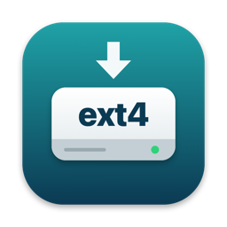

# Ext4 Automount for macOS

Plug in an ext4 (Linux) drive and it mounts **read-write** in Finder automatically.
Eject it in Finder, or from the menu bar icon, and the drive powers down like any other disk.

macOS can't write to ext4 drives on its own. [anylinuxfs](https://github.com/nohajc/anylinuxfs)
can: it mounts the drive in a small Linux VM and shares it to macOS, with no kernel
extension. But you have to run `sudo anylinuxfs /dev/diskXsY` every time you plug the drive
in. Ext4 Automount does that for you.

## Install

1. Download `Ext4-Automount-<version>.pkg` from the
   [latest release](https://github.com/sahilas/ext4-automount-macos/releases/latest).
2. Open it. Releases are not notarized by Apple yet, so macOS blocks a double-click:
   right-click the file and choose **Open**, or allow it under
   **System Settings > Privacy & Security > Open Anyway**.
3. Follow the installer and enter your password.
4. A setup window opens with a short checklist. Click **Open Full Disk Access Settings…**
   and turn on the switch next to **Ext4 Automount**. Each line turns green when it's done.

Then plug in your drive. It appears under `/Volumes/<label>` within about 10 seconds.
The very first mount takes about a minute, because anylinuxfs downloads a small Linux image.

The installer needs [Homebrew](https://brew.sh). It installs anylinuxfs for you if it is
missing.

With Homebrew instead:

```bash
brew tap sahilas/ext4-automount-macos https://github.com/sahilas/ext4-automount-macos
brew install --cask ext4-automount
```

### Why Full Disk Access?

macOS privacy controls stop background services from reading external disks. macOS only
lets you turn this on yourself; no installer can do it. The switch covers this one app, not
your shell or other scripts.

Releases are ad-hoc signed, so macOS treats each new version as a new app. After an update,
turn the switch on again.

## Using it

The menu bar icon shows connected Linux drives:

- **Open \<drive\>** and **Eject \<drive\>** for a mounted drive. Ejecting also ejects the
  disk, and Finder's eject does the same.
- **Mount \<drive\>** for a drive that is connected but ejected.
- **Pause Auto-Mount** stops new drives from mounting until you turn it off.
- **Options**
  - **Mount Read-Only**
  - **Make All Files Writable for Me**, for files created by another user on Linux
  - **Never Mount**, per connected drive
- **Check for Updates…** The app also checks once a day and shows **Update Available**.
  The check asks GitHub for the latest release and sends nothing about your Mac.
- **Finish Setup…** appears, with a warning icon, while Full Disk Access is off.
- **Open Log** shows what the service did.

You get a notification when a drive is ready; click it to open the drive. Allow
notifications for Ext4 Automount when macOS asks.

After you eject a drive, it stays unmounted until you unplug it and plug it back in, or
choose **Mount \<drive\>**.

## Options file

The menu covers the common options. The rest live in
`/Library/Application Support/Ext4 Automount/config` (copy `config.example` in that folder;
needs `sudo`). Changes apply the next time a drive mounts.

| Option | Default | Meaning |
|---|---|---|
| `FILESYSTEMS` | `ext2 ext3 ext4` | Filesystems to mount. anylinuxfs also supports others, such as `btrfs` and `xfs`. |
| `READ_ONLY` | `no` | Mount drives read-only. |
| `IGNORE_PERMISSIONS` | `no` | Treat all files as yours, so files created on Linux are writable. |
| `IGNORE` | empty | Labels or filesystem UUIDs of drives never to mount. |

## Uninstall

Choose **Uninstall…** from the menu bar icon and enter your password. Or in Terminal:

```bash
sudo "/Applications/Ext4 Automount.app/Contents/Resources/uninstall.sh"
```

This removes the app, the service, its settings and its Full Disk Access entry. anylinuxfs
stays installed.

## How it works

`Ext4 Automount.app` is one program with two roles:

- **Service** (`--daemon`, run as root by launchd). It listens for disk events from
  DiskArbitration, so it does nothing while idle. For each external partition it asks
  `blkid` for the filesystem type. If the type is on the list, it runs `anylinuxfs mount`
  on behalf of the logged-in user. When the volume is unmounted, it ejects the disk.
- **Menu bar app** (run as you at login). It reads the service's status file and shows
  notifications. To mount a drive or change an option, it drops a small request file that
  the service validates; it never runs anything as root itself.

Files it installs:

- `/Applications/Ext4 Automount.app`
- `/Library/LaunchDaemons/local.ext4-automount.plist`
- `/Library/LaunchAgents/local.ext4-automount.menu.plist`
- `/Library/Application Support/Ext4 Automount/`
- `/etc/newsyslog.d/ext4-automount.conf` (rotates the log at 1 MB, keeps 3)

## Troubleshooting

The log is at `/var/log/ext4-automount.log`.

| Symptom | Fix |
|---|---|
| Warning icon in the menu bar | Turn on Ext4 Automount under Full Disk Access. Waiting drives mount within a few seconds. |
| "\<drive\> is read-only" notification | Another ext4 driver (for example ExtendFS) mounted it first. Remove that app, or disable it with `pluginkit -e ignore -i <id>`, then replug. |
| "Couldn't mount" notification | Run `anylinuxfs log` to see why anylinuxfs failed. |
| "\<drive\> is waiting" | Only one Linux drive mounts at a time. Eject the current one. |
| The disk reappears right after ejecting | Some USB enclosures reconnect after an eject. The drive isn't mounted, so it's safe to unplug. |
| Replugged drive doesn't mount | It was replugged within 20 seconds of an eject. Choose **Mount \<drive\>** from the menu bar icon. |

## Limitations

- One Linux drive at a time. A second drive waits until the first is ejected.
- Nothing mounts while no one is logged in. With fast user switching, drives mount for the
  user at the screen.
- Encrypted (LUKS) and LVM volumes are not mounted automatically. Use `anylinuxfs` directly.
- Tested on Apple Silicon with macOS 27. The app is built for Intel and macOS 11 or later
  too, but that is untested.
- A drive that reconnects within 20 seconds of an eject is not mounted automatically,
  because some enclosures reconnect by themselves. Choose **Mount \<drive\>** from the menu.

## Build from source

Needs Xcode command line tools (`xcode-select --install`).

```bash
packaging/build-pkg.sh 1.2.0
open dist/Ext4-Automount-1.2.0.pkg
```

Pushing a tag such as `v1.2.0` runs the release workflow. It builds the installer, attaches
it to a GitHub release and updates the Homebrew cask.

To ship a signed and notarized installer, which opens with a plain double-click, you need
an Apple Developer account. Set `APP_SIGN_ID`, `INSTALLER_SIGN_ID` and `NOTARY_PROFILE` for
a local build (see `packaging/build-pkg.sh`), or the secrets listed in
`.github/workflows/release.yml` for releases.

## License

MIT. anylinuxfs is a separate project under GPL-3.0. This project only runs it.
